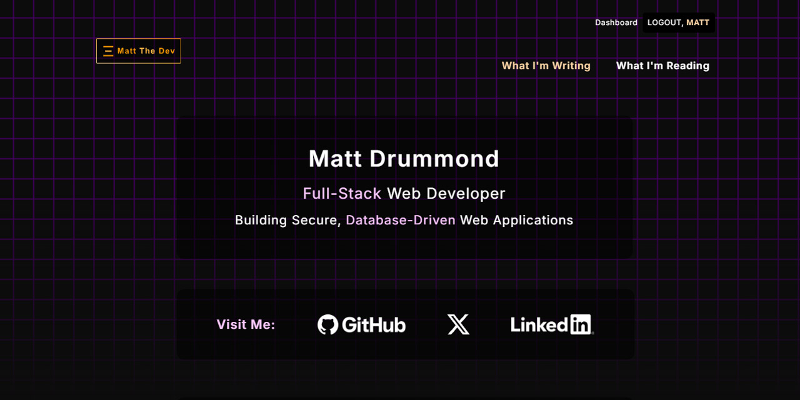
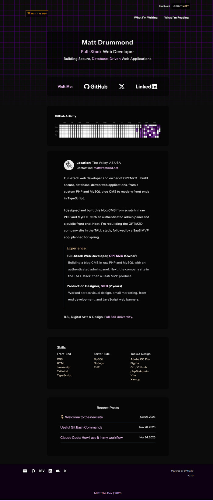
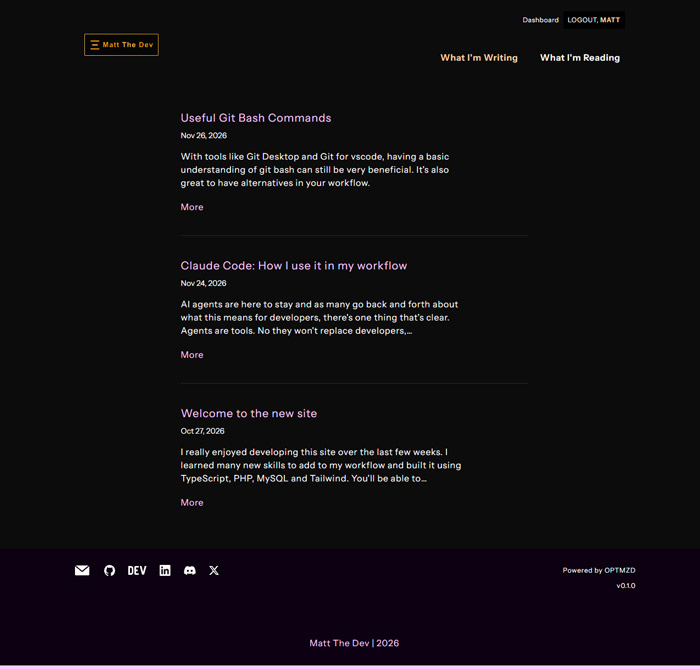
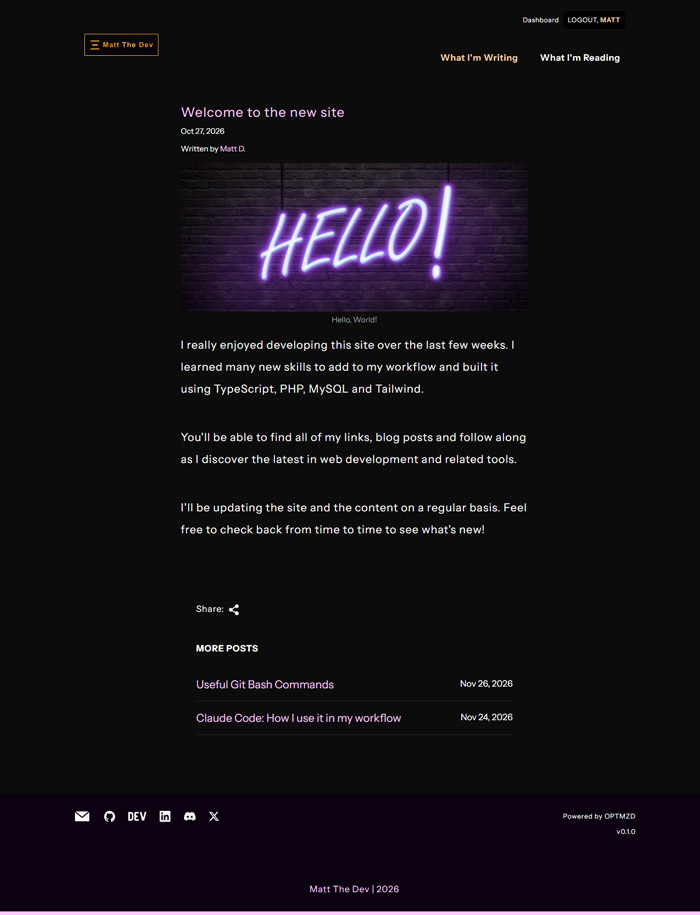
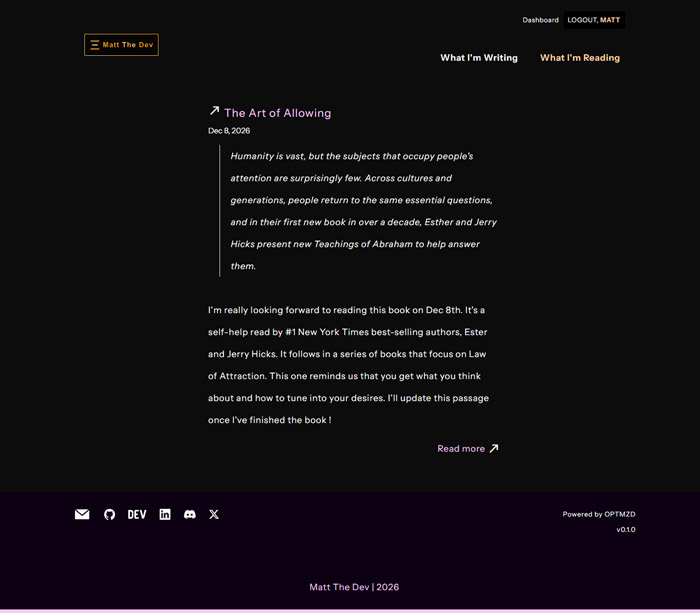
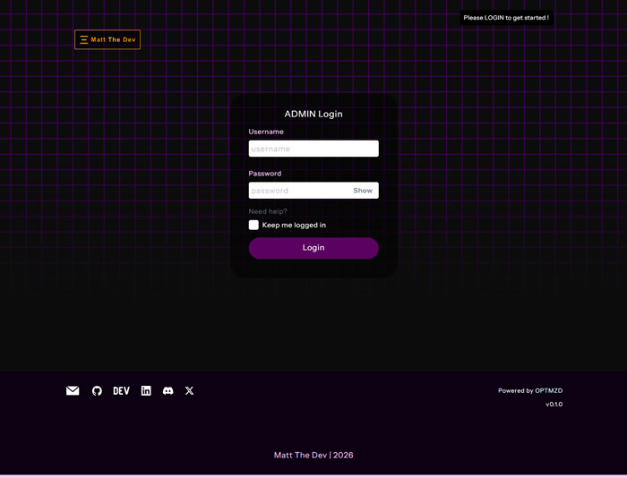
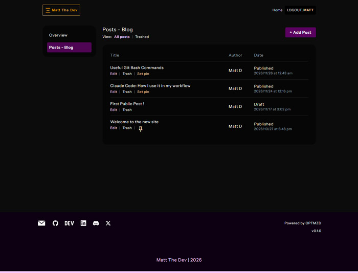
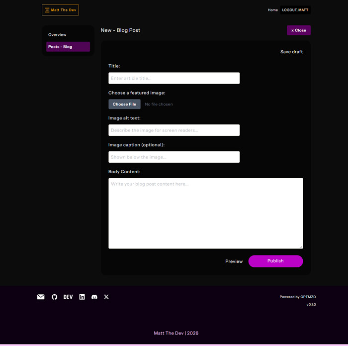
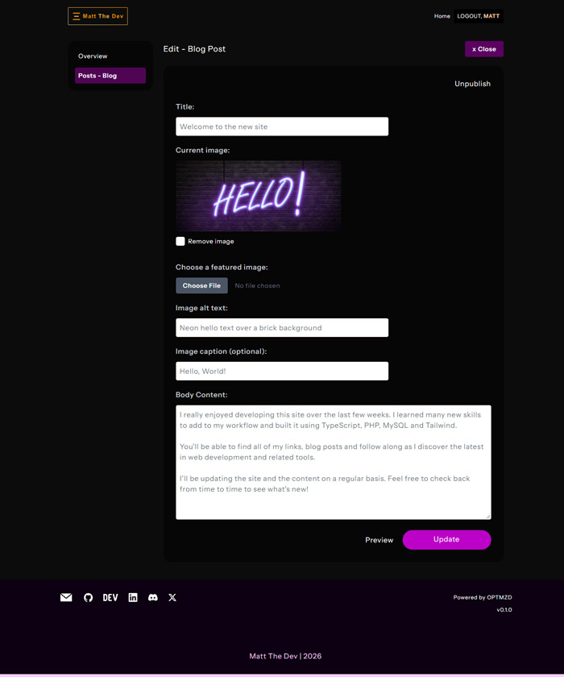

# Blog CMS Application

A custom blogging platform with a public frontend and an admin CMS for managing posts. I'm building it to learn how the whole web stack fits together.

Built with help from Claude Code, which I used for explanations, planning and code review. I wrote the PHP myself.

&nbsp;

&nbsp;

**Stack:** Vite, Tailwind CSS v4, TypeScript, Figma. Backend: PHP (PDO) and MySQL (in progress).

**Security:** prepared statements for every query, CSRF tokens on every form that saves data, passwords hashed with `password_hash()`, hardened session cookies with inactivity timeouts, and login attempt limiting.

### Status
- [x] Visual design in Figma
- [x] Vite and Tailwind setup
- [x] Client-side frontend
- [x] Admin / CMS frontend
- [x] Apache htdocs migration / server-side preparation
- [x] Login system and sessions (login, logout, protected admin pages, "Keep me logged in", inactivity timeouts, CSRF tokens, login attempt limiting)
- [x] Blog posts
  - [x] Database table
  - [x] Admin list with trash, restore and permanent delete
  - [x] New post saving (draft or publish), with a session keep-alive while typing
  - [x] Featured image upload (type and size checks, random file names, the old file deleted when it's replaced, removed or the post is deleted)
  - [x] Edit form, merged with the new post form
    - [x] Load a post into the form, update its text and status
    - [x] Keep, replace or remove the featured image
    - [x] Save draft returns to the edit form, Publish goes to the list
    - [x] A flash message for each button (saved, published, updated, unpublished)
  - [x] Public post pages (post list and single post page; pagination comes later)
  - [x] Recent Posts on the home page, with one post pinned from the admin list

### Planned
- Pagination on the post list
- Deploy to production (v0.1.0)
- After launch: reading posts, user management, access requests and site settings, released as they're finished on the way to v1.0.0
- Categories and comments tables
- JSON endpoints for features that don't reload the page (e.g. draft autosave)

### Running locally
1. Install [XAMPP](https://www.apachefriends.org/) and put the project in `htdocs/blog-cms`, so it's served at http://localhost/blog-cms/.
2. Run `npm install`, then `npm run build`. The `build/` folder isn't committed, so the pages have no CSS or JS until you build. While working, `npm run watch` rebuilds on every save.
3. In phpMyAdmin, create a database named `dynamicblog`, select it, and import `database_schema.sql` from the Import tab. That creates the `users`, `login_attempts` and `blog_posts` tables, with no data.
4. Copy `includes/dbh.inc.example.php` to `includes/dbh.inc.php` and fill in your database credentials. That file is gitignored.
5. Add an admin user by hand, with a password hash made by `password_hash()`. There's no signup page.

&nbsp;

### Screenshots - Client Side

&nbsp;

&nbsp;

&nbsp;

&nbsp;

***

### Screenshots - Admin

&nbsp;

&nbsp;

&nbsp;

